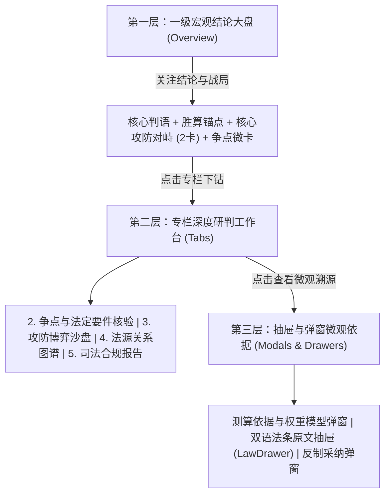

# 海外法律查明系统（OverseasLawAssist）前端设计原则与实施规范

> **版本**：v2.0（正式规范版）  
> **适用范围**：系统全站前端架构、各业务页面（总览大盘、争点核验、攻防沙盘、法源图谱、合规质检、新建向导及历史台账）  
> **核心定位**：**现代法律科技（Legal Tech + AI）与涉外司法严谨性的深度统一**

---

## 核心设计理念

摒弃传统律所软件与学术工具陈旧、晦涩、压抑的“卷宗感”与“大段文字堆砌”，深度对齐 **Apple Human Interface Guidelines (HIG)** 与 **Microsoft Fluent Design System** 的现代化信息架构（Visual Information Architecture, VIA）。

用户在系统的每一次交互中，应直观感知到：
1. **AI 法律科技的轻盈通透**：清爽卡片化、呼吸留白、毫秒级响应、沉浸式推演过度；
2. **涉外法律研判的严谨秩序**：因果闭环、条文溯源、权重透明、四段论规范论证。

---

## 一、 信息架构与布局原则 (VIA & Layout)

### 1.1 渐进式信息披露原则 (Progressive Disclosure)
严禁将所有法律条文、因果三段论与测算公式平铺在同一页面，严格划分为三个呈现梯次：

* **宏观总览（Overview）坚决贯彻“精炼定论 + 关键对抗”原则**：
  * 总览页面只呈现决策者最关心的三件事：**全案胜算倾向**、**对方最大威胁与应对**、**核心争点速览**；
  * **严禁在总览页塞入长篇大论的三段论法理细节或法条全文**。法条细节与辩论推导一律收敛于子页面或侧边抽屉。
* **微观依据收敛于抽屉与弹窗**：
  * 胜算权重与测算公式收敛在 `ViabilityCalculationModal` 弹窗；
  * 权威法条与判例双语全文收敛在 `LawDrawer` 侧边抽屉；
  * 保证主视界焦点始终停留在案件战略态势本身。

### 1.2 视觉锚点与戏剧性排版反差 (Visual Anchor & Typography Contrast)
* **左侧 64px~72px 巨型数据视觉锚点**：
  * 在全案核心定论看板左侧，以 `text-6xl sm:text-7xl font-bold font-mono tracking-tight text-slate-900` 呈现核心胜算概率（如 `87%` / `92%`），搭配浅色轻量 `%` 符号与动态脉冲评级标签；
  * 配备**微缩请求权确定性光谱条**（涵盖实体要件 55%、法源支撑 32%、抗辩防御 13%），替代枯燥文字标签；
  * 核心定性判语作为定论结论自然展开，关键权利诉求采用底纹高光与下划线标记，形成黑白分明、一眼定焦的权威气场。
* **坚决消除指标与图表重复**：
  * **严禁在同一视界内同时出现巨型机械仪表盘与横向长条进度条**；
  * 综合胜算概率在总览卡片中有且仅有一次高光呈现，次级维度（要件、攻防、法源、质检）以通透无框极简数据列排列，绝不喧宾夺主。

### 1.3 对称均衡与信息图形化 (Data Viz & Balance)
* **攻防态势采用等高双栏对峙卡片 + 攻防力量博弈条 (Tug-of-War Bar)**：
  * 攻防对抗顶部增设动态攻防博弈条，直观展示我方实体主张力量（`85%~92%`）与对方程序时效风险（`55%->5%`）的对抗张力；
  * 攻防两卡采用纯白通透玻璃材质，**坚决杜绝整卡大面积蓝底或黄底的视觉冲撞**；改用左侧 4px 语义色条（蓝/琥珀/翠绿）与状态圆点精细传达态势；
  * 杜绝三栏断层或内容拉伸造成的中间/右侧大面积空白。
* **争议焦点微缩数据图示化 (Micro-Charts)**：
  * 彻底杜绝所有争点卡片千篇一律堆砌 100% 进度条；
  * 为不同性质争点量身定制微缩信息图例：意思自治确定性图签、技术公差偏离刻度尺、合理异议时效节点轴（`D0 交付 ──► D23 通知 ──► D30 阈值`）等。
* **动态栅格自适应（防断行孤立）**：
  * 争点卡片等确定数量的列表，采用动态列宽响应（例如 3 项争点为 `lg:grid-cols-3`，4 项争点为 `lg:grid-cols-4`），严禁出现 3+1 单独折行落单。

---

## 二、 交互与动态反馈原则 (Interaction & Motion)

### 2.1 闭环实战反制与胜算即时重估
* **高光交互入口**：
  * 攻防对峙中的【对方威胁卡】必须作为直接实战交互枢纽。当存在抗辩敞口（如 55% 抵御力）时，提供显著的 CTA 操作入口（`[查看应对方案并实施胜诉测算 (+7%)] ➔`）。
* **推演过渡动效（Pacing Rule）**：
  * 采纳反制策略后，严禁界面瞬间生硬跳变；
  * 必须启动平滑递进的**三阶段推演过渡动效**（事实证据调取 ➔ 先例阻断抗辩 ➔ 四维权重重估），让用户清晰感知 AI 与司法逻辑演练的严谨推导。
* **即时联动胜算跃升与状态更新**：
  * 推演完成后，全案微度规平滑递增（如 `85% ➔ 92%`）并点亮翡翠绿高光；
  * 对方威胁卡转为翡翠绿阻断态（`对方抗辩已成功阻断 · 反制已落实 (95%)`）；
  * 核心判语同步更新为反制成功后的最终法律结论。

### 2.2 跨案件状态严格隔离 (Cross-Case State Isolation)
* **绝对隔离各案件的交互状态**：
  * 任何反制补强、证据勾选、调证记录均必须基于 `case_id` 进行独立持久化与隔离（如 `caseEvidences[currentCaseId]`）；
  * 严禁用户在 C001 中确认落实反制后，切换到 C002、C003 或涉美案件时污染其对抗状态。

### 2.3 微交互反馈标准 (Micro-interactions)
* **可点击元素触感**：
  * 按钮点击附带微弹性反馈（`active:scale-[0.98]`）；
  * 卡片悬停微浮起（`hover:-translate-y-0.5 hover:shadow-md hover:border-blue-400/80`）；
  * 等宽数字支持平滑计数增长（Count-up）。

### 2.4 全局悬浮 AI 推演指令舱 (Floating Copilot Command Bar)
* **独立视口置顶（Portal to Body）与动态视觉居中**：
  * 使用 React `createPortal(..., document.body)` 挂载，彻底摆脱页面主滚动容器（`overflow-y-auto`）对 `fixed` 定位的包含块干扰；
  * **主工作区视觉居中偏移计算**：由于左侧存在 268px（展开）或 76px（折叠）的侧边栏，传统 `left-1/2` 会导致胶囊偏向页面左侧。指令舱自适应根据侧边栏状态计算 `left: calc(50% + ${sidebarCollapsed ? 38 : 134}px)` 并平滑过渡，确保在任何视口下精准落在右侧主画布视觉中心。
* **浅色磨砂质感与极致压缩微胶囊形态**：
  * **浅色 Apple 磨砂质感**：摒弃醒目的全黑/深色胶囊，改用 Apple 浅色微透毛玻璃（`bg-white/90 backdrop-blur-2xl border border-slate-200/90 shadow-[0_4px_20px_rgba(15,23,42,0.08)]`），彻底融入整体浅色高雅背景；
  * **收折态尺寸极致微缩**：宽度收敛至 `w-[156px]`，高度压缩至 `h-[32px]`，内嵌 2px 呼吸微圆点、`⌘K` 极简微键标与微型文本，极致轻量，不遮挡业务正文；
  * **展开态高效聚焦**：最大宽度控制在 `max-w-xl`（576px），高度 `h-10`（40px），浅色底座搭配蓝色聚焦光球与操作按钮，弹簧动效平滑形变，支持全键盘极速交互。
* **实战推演与变量选择**：
  * 支持输入假设变量（如“若通知延迟至第45天？”）或点击胜败关键变量，直接调用后端 `/cases/{id}/chat` 接口触发法理重算与胜算重估。

---

## 三、 文案表达与术语通俗化原则 (Copywriting Standards)

### 3.1 法律专业术语通俗化对照表
严禁使用法理学中晦涩冷僻、对商事业务人员极不友好的生硬词汇，一律按以下标准执行替换：

| 严禁/淘汰表述（生硬/晦涩/冷僻） | 规范化替换表述（精准/通俗/实战） | 优化原由 |
| :--- | :--- | :--- |
| **四段论涵摄审查** / **法定要件涵摄** | **法定构成要件审查** / **构成要件核验** | “涵摄”（Subsumption）过于学理化，要件核验更符合审判实务认知。 |
| **心证推移** / **心证分水岭** | **裁判心证关键焦点** / **核心胜败关键点** | “心证”属于法官内心确信术语，“胜败关键点”直观指导律师与客户决策。 |
| **对抗态势矩阵**（堆砌法条版） | **诉讼胜算与攻防对抗态势**（精简对峙版） | 突出两军对垒与实战应对，消除学术大矩阵的压迫感。 |
| **变量 #1, #2** | **关键要害 01, 02** | 案件对抗并非数学变量，要害交锋更具法律对抗感。 |
| **法律 Copilot 智能追问助手** | **查明 Agent 咨询** | 紧扣域外法查明业务主题，统一 Agent 产品品牌。 |
| **案件数据库与台账** | **历史查明案件** | 消除行政刻板色彩，“历史查明案件”契合用户使用习惯。 |

### 3.2 严禁技术泄漏与空洞营销辞藻
* ❌ **严禁展示底层技术堆栈**：界面严禁出现“双 SQLite WAL 架构”、“只读快照模式”、“Multi-Agent 协作流水线”等内部工程术语。
* ❌ **严禁廉价自嗨营销词**：严禁出现“全球首创 AI 引擎”、“以某法为权威数据底座”等空洞口号，保持严肃专业的司法中立基调。
* ✅ **结构化精炼表述**：所有事实与法理判语严格遵循 **“法定请求权基础 + 1句核心定性 + 现行法典依据”** 的三段式精炼排布。

---

## 四、 视觉材质、色彩与排版原则 (Materials & Styling)

### 4.1 容器材质与光影景深 (Glassmorphism & Depth)
* **无界同色系浸润与 Mica 悬浮侧边栏**：
  * 彻底摒弃传统硬切深藏蓝侧边栏（`bg-[#0c162d]`），改用 Apple / Fluent 2 Mica 材质的浅色悬浮侧边岛（`apple-sidebar-panel`，四边留出 12px 呼吸边距，圆角 `rounded-[28px]`，`bg-white/75 backdrop-blur-2xl border border-white/85 shadow-sm`）；
  * 页面底座采用双极光弥散底座（左上蓝紫 + 右上青绿，600px 柔光光晕），让 72% 透明度的真·亚克力毛玻璃卡片（`.apple-bento-card`）真正折射光彩。
* **真·亚克力毛玻璃卡片 (.apple-bento-card)**：
  * 主容器采用连续大圆角 `rounded-[32px]` 与真·毛玻璃底色（`bg-white/72 backdrop-blur-24px saturate(180%)`）；
  * 具备 **1px 顶部白色镜面内高光（`shadow-[inset_0_1px_0_0_rgba(255,255,255,0.95)]`）** 与多层柔和弥散阴影；
  * 彻底解决 95% 白色实心块遮挡底下弥散光晕的视觉问题。

### 4.2 符号与图标选用禁令 (Iconography)
* ❌ **坚决摒弃廉价与陈旧符号**：
  * **严禁出现天平图标（`Scale` / ⚖️）**：传统天平图库素材极具廉价模板感，且缺乏数字化信息量；
  * **严禁出现法院木槌、羊皮纸卷轴、古典罗马柱**等陈旧司法符号。
* ✅ **统一采用现代抽象语义图标**：
  * 构成要件与层级：`Layers`
  * 规范锁定与防线：`ShieldCheck`
  * 对抗态势与交锋：`Swords`
  * 胜算推演与 AI 计算：`Sparkles`
  * 权威法源与判例：`BookOpen`
  * 司法质检合规：`CheckCircle2`

### 4.3 色彩语义系统规范
严格遵循 **95% 极简克制黑白灰 + 5% 高对比语义强调色**，严禁满屏花哨杂色：

| 语义角色 | Tailwind 类名 | 规范使用场景 |
| :--- | :--- | :--- |
| **主基底 / 主文本** | `slate-900` | 一级定论大标题、核心指标数字、主要按钮。 |
| **科技交互色** | `blue-600` / `blue-50` | AI 状态标识、主交互操作按钮、查看依据链接。 |
| **正向胜诉 / 阻断** | `emerald-600` / `emerald-50` | 构成要件齐备、时效抗辩成功阻断、质检全项合规。 |
| **风险预警 / 抗辩** | `amber-600` / `amber-50` | 存在时效失权抗辩敞口、待调取补充证据、争议要点。 |
| **成文法源 / 图谱** | `indigo-600` / `indigo-50` | 官方现行 A 级法典条文、法源关系引证网络节点。 |

### 4.3.1 动态概率进度条与统一色彩规范 (Unified Light Blue Bars & Clean Accent Standards)
“克制是为了重点突出时能够引起用户注意，绝非五颜六色”。统一色彩能降低用户的视觉认知噪音，并将注意力精准聚焦在异常点与薄弱要害上：
* **核心胜诉概率条**：
  * 胜诉概率使用高质感浅蓝微光泽条（`bg-sky-500 shadow-[0_0_8px_rgba(14,165,233,0.25)]`），搭配浅灰轨道 `bg-slate-100`；
  * 摒弃过多的彩虹色跨度渐变，保持现代律政风格的沉稳与高级。
* **攻防博弈力量对抗条 (Tug-of-War Bar)**：
  * 我方实体优势侧：统一选用浅蓝 `bg-sky-500`；
  * 对方抗辩风险侧：文案保持中性灰（`text-slate-600`），**仅将风险百分比（如 `13%`）高亮为橙色（`text-amber-600 font-bold font-mono`）**，避免整行红黄的警示焦虑；
  * 彻底清理“1 项程序敞口”等非必要的赘余文字标签。
* **次级 100% 齐备度进度条统一浅蓝色（No Rainbow Bars）**：
  * 法定要件齐备度（100%）、权威法源有效性（100%）、最高院规范质检（11/11）**一律统一定义为浅蓝色（`bg-sky-500`）**；
  * 唯有存在未阻断敞口的程序抗辩防御力（55%）使用醒目橙色（`bg-amber-500`）；未被打破的维度保持高度纯净的一致感。
* **争议焦点微卡去条化与橙色短下划线规范**：
  * **争议焦点卡片彻底移除下方冗余微进度条**，杜绝千篇一律的横条噪音；
  * “需反制补强”文字保持黑色（`text-slate-900 font-medium`），仅在其下方搭配一条**橙色短下划线（`border-b-2 border-amber-500 pb-0.5`）**作为极简视觉提醒，杜绝彩色文字和胶囊底色。
* **页面级流体切换动效 (.apple-page-pane)**：
  * 采用位移（`translateY(18px)`） + 空间微缩放（`scale(0.99)`） + 景深微模糊（`filter: blur(4px) -> blur(0)`）的复合入场动画；
  * 配合 `360ms cubic-bezier(0.16, 1, 0.3, 1)` 与 `transform-origin: 50% 15%`，彻底解决单薄淡入难以感知的痛点。

### 4.4 字体与等宽字体约束 (Typography Constraints)
* **全局正文字体**：现代系统无衬线字体栈（`Inter, -apple-system, BlinkMacSystemFont, "Segoe UI", PingFang SC, sans-serif`）。
* **等宽字体（`font-mono`）严格限制原则**：
  * ✅ **允许且推荐使用**：百分比与分数（`85%`）、案件编号（`C001`）、成文法典条文号（`BGB § 437`、`HGB § 377`、`UCC § 2-608`）、质检代码（`V1~V11`）、时间戳。
  * ❌ **严禁滥用**：严禁用在大段中文正文、常规小标题、说明段落中，保持中文阅读的优雅与舒适。

### 4.5 严禁浅色背景胶囊与 AI 味标签滥用 (Anti-Capsule & Micro-Dot Standard)
* ❌ **坚决摒弃浅色椭圆彩色胶囊（AI-generated Pill Badges）**：
  * 严禁满屏铺设 `rounded-full bg-blue-50 border-blue-200 text-blue-700`、`bg-amber-50 text-amber-800`、`bg-emerald-50 text-emerald-800` 等糖果色背景胶囊标签；
  * 这类胶囊是模板化 AI 生成界面的典型特征，视觉杂乱且缺乏权威专业感。
* ✅ **统一采用 Apple 规范的状态微圆点与中性排版层次（Apple Micro-Dots & Neutral Typography）**：
  * 状态指示统一通过 **6px 状态微圆点（`w-1.5 h-1.5 rounded-full bg-emerald-500` / `bg-amber-500` / `bg-slate-300`）+ 中性灰文字（`text-slate-600 font-medium`）** 表达；
  * 必需的容器或分类标签采用紧凑微圆角（`rounded-md` / `rounded-lg`）+ 中性浅灰基底（`bg-slate-100 text-slate-700 border border-slate-200/60`），严禁使用高饱和度彩色底色；
  * 字体颜色保持严格克制：正文和标题严格统一为 `text-slate-900`（大标题/核心数值）、`text-slate-700`（正文次要）、`text-slate-500` / `text-slate-400`（注释/元数据），除状态微圆点外杜绝满屏彩色文字与花哨底纹。

---

## 五、 数据真实性与自适应原则 (Data Integrity)

1. **彻底移除前端假数据硬编码**：
   * 所有争点、要件、法源、抗辩必须完全绑定后端真实结构化对象（`currentCase.issues`、`elements`、`strategic_assessment`、`evidence`、`checks`）；
2. **多法域自适应**：
   * 前端逻辑自动识别涉外法域（如德国联邦法 `BGB/HGB` vs 美国统一商法典 `UCC`），条文依据、请求权基础、争议焦点自动动态切换，严禁写死单一案件的专属术语。

---

## 六、 前端开发与自检清单 (Pre-Flight Checklist)

每次修改或新增前端模块前，必须严格对照以下 11 项自检：

- [ ] **1. 总览是否精简？** 总览大盘是否只保留核心定论、度规与攻防对峙，未堆砌大段法条全文？
- [ ] **2. 视觉锚点是否明确？** 核心定论卡片是否有紧凑度规（Micro-Dial）作为锚点，文字是否不再像孤立大标题？
- [ ] **3. 是否存在指标重复？** 是否已彻底杜绝巨型机械仪表盘与横向重复进度条并存的现象？
- [ ] **4. 攻防对峙是否对称无空白？** 攻防卡片是否左右对称等高，中间与右侧无畸形大面积空白？
- [ ] **5. 对方威胁卡是否具备反制闭环？** 点击威胁卡是否能弹出应对方案，并在采纳后呈现三阶段平滑推演动效？
- [ ] **6. 跨案件状态是否严格隔离？** 在当前案件落实反制后，切换至其他案件是否不会出现状态污染？
- [ ] **7. 术语是否已通俗化？** 是否已彻底消除“涵摄”、“心证推移”等晦涩生词与底层技术泄漏？
- [ ] **8. 符号是否杜绝廉价感？** 是否零天平图标（`Scale` 数量为 0），零法槌等陈旧素材？
- [ ] **9. 等宽字体是否受控？** `font-mono` 是否仅用于数字、代码与条文编号，中文正文无滥用？
- [ ] **10. 是否杜绝浅色背景胶囊？** 状态是否使用 Apple 6px 状态微圆点与中性排版层次，彻底消除糖果色椭圆胶囊？
- [ ] **11. 编译与打包是否零警告？** `npm run build` 是否顺畅通过且构建无报错？
