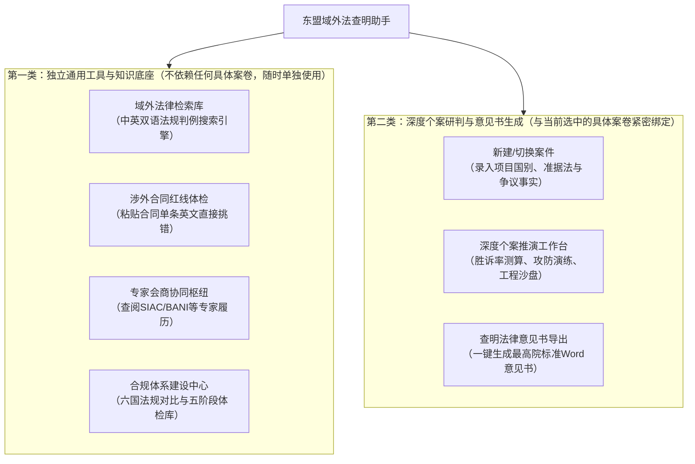

# 东盟域外法查明助手 — 用户使用指南

> **适用对象**：中国中铁、中国交建、中国电建等央国企涉外法务人员、海外项目经理、涉外律师及合规主管。  
> **编写宗旨**：本指南不包含任何晦涩的技术开发术语，完全以**业务使用场景、功能操作路径、产出成果解读**为导向，帮助您快速熟练使用本系统，有效防范东盟涉外建设工程与投资法律风险。

---

## 目录
1. [系统整体概览与两大类工具划分（核心解惑）](#1-系统整体概览与两大类工具划分核心解惑)
2. [核心功能详解与用户操作全景](#2-核心功能详解与用户操作全景)
   * [2.1 央国企东盟工程与投资合规体系建设中心（非案件绑定·事前全景指引）](#21-央国企东盟工程与投资合规体系建设中心非案件绑定事前全景指引)
   * [2.2 域外法律检索库（非案件绑定·日常独立法规与判例查询）](#22-域外法律检索库非案件绑定日常独立法规与判例查询)
   * [2.3 涉外合同强行法红线独立体检（非案件绑定·单条款极速审查）](#23-涉外合同强行法红线独立体检非案件绑定单条款极速审查)
   * [2.4 东盟境外律师与争议评审专家协同枢纽（非案件绑定·专家与避冲排查）](#24-东盟境外律师与争议评审专家协同枢纽非案件绑定专家与避冲排查)
   * [2.5 深度个案推演与审查工作台（个案强绑定·核心重型武器）](#25-深度个案推演与审查工作台个案强绑定核心重型武器)
   * [2.6 查明法律意见书导出工作台（个案强绑定·正式公文成果交付）](#26-查明法律意见书导出工作台个案强绑定正式公文成果交付)
3. [典型业务场景手把手实操全流程](#3-典型业务场景手把手实操全流程)
   * [场景 A：从零发起一个海外项目的法理深度查明与沙盘测算](#场景-a从零发起一个海外项目的法理深度查明与沙盘测算)
   * [场景 B：快速核查一段英文合同专用条件是否存在属地强行法“硬伤”](#场景-b快速核查一段英文合同专用条件是否存在属地强行法硬伤)
   * [场景 C：日常查找东盟某国现行有效法条原文与最高法院裁判要旨](#场景-c日常查找东盟某国现行有效法条原文与最高法院裁判要旨)
   * [场景 D：对即将签约或在建项目开展全流程合规健康度体检](#场景-d对即将签约或在建项目开展全流程合规健康度体检)
4. [新手高频困惑与答疑（FAQ）](#4-新手高频困惑与答疑faq)

---

## 1. 系统整体概览与两大类工具划分（核心解惑）

在使用本助手时，最重要的一点是理解系统内工具分为两大截然不同的类别：



### 核心解惑速览：
1. **“合规中心”、“检索库”、“合同体检”、“专家枢纽”** 是面向日常法务工作的**通用工具箱**。无论系统当前是否加载了案件，您都可以随时打开它们进行查法条、验条款、选专家。
2. **“深度个案推演工作台”与“意见书导出”** 是**案件专属性工作台**。其展示的数据（如综合胜诉率、工程沙盘滑块、争点要件、反制证据）完全取决于您当前在系统顶栏选中的是哪一个具体项目（如 C101 印尼火电项目、C102 越南光伏项目）。

---

## 2. 核心功能详解与用户操作全景

### 2.1 央国企东盟工程与投资合规体系建设中心（非案件绑定·事前全景指引）

#### 【功能定位】
这是为海外事业部法务、海外商务拓展人员准备的**东盟基建与投资法律合规全景库**。它不是单个案件的裁决书，而是一套成体系的“法规地图”与“防雷指南”。

#### 【四大标签页到底怎么用？】
很多用户切换四个标签页后觉得“字很多、不知道怎么用”，其实每个标签页都有明确的**交互操作与核心产出**：

1. **标签页 1：全周期合规指引引擎（五阶段三防线）**
   * **操作方式**：上方选择项目所处阶段（投前准入、投建招标、履约施工、竣工运营、争端化解）。下方会呈现该阶段必须核查的 6~9 项关键合规红线。**每一项的右侧均设有交互判定按钮**（`✓ 已满足` / `! 瑕疵` / `✕ 未达标`）。
   * **产生结果**：当您根据自己项目的真实情况逐项打勾后，顶部会实时计算出您当前项目的**合规健康度总评分（0~100 分）**与雷达健康状态。
   * **怎么看结果**：如果评分高于 85 分，说明项目在该阶段基础扎实；如果存在 `✕ 未达标` 项，系统会标红提示，您可以直接点击该项右侧的“转入个案查明”，把这个隐患直接孵化成案卷深入分析。
2. **标签页 2：6×12 高频合规风险提示矩阵**
   * **操作方式**：横轴是东盟 6 个国家（印尼、越南、马、新、泰、菲），纵轴是涉外工程最常踩坑的 12 大风险域（资质牌照、外资股比、土地习惯法、合同语言签署、本地化率 TKDN、外劳配额、工期延误失权、背靠背付款、见索即付保函、特许权征收、税务常设机构、数据出境）。
   * **产生结果**：**矩阵表格中的每个彩色圆点都可以直接点击**！点击后会弹出一份针对该国该事项的标准化《专项风险提示卡》，清晰列出 **“必须做的 3 件事 (Do's)”** 与 **“严禁做的 3 件事 (Don'ts)”**。
   * **怎么看结果**：红色（🔴）代表东道国法律绝对强制穿透（不可排除，违反导致合同自始无效）；橙色（🟠）代表高危违约；黄色代表中度关注。
3. **标签页 3：东盟六国法制横向对比矩阵**
   * **操作方式**：上方选择您关心的维度（如“双语签署要求”、“见索即付保函止付门槛”、“背靠背条款效力”）。
   * **产生结果**：系统自动将 6 个国家在该维度下的法律条文依据、司法实践宽严程度、违规后果并排对照呈现。
   * **怎么看结果**：适合海外市场开拓部在“多国投标比选”或“投资架构选址”时，直观横向比较哪个国家的法律环境更宽松、哪国监管最严苛。
4. **标签页 4：典型案例五维复盘卡**
   * **操作方式**：点击不同案例卡片（如印尼纯英文合同无效纠纷、马来西亚 CIPAA 停工快速裁决案）。
   * **产生结果**：获取法院真实裁判观点、同类案情的裁判共识与中企教训复盘。

> **关于页面中的“新建个案查明”按钮与侧边栏按钮的区别**：  
> 两者底层打开的是同一个“案件录入窗口”。合规中心内的按钮是方便您“在看合规指南时突然发现手头项目有合规缺口，无需退回主页，直接原地建案”的快捷通道。

---

### 2.2 域外法律检索库（非案件绑定·日常独立法规与判例查询）

#### 【功能定位】
类似于涉外法务专用的“东盟法律百度”或“官方司法公报镜像”，独立于任何案件而存在。

#### 【初次打开为何显示“检索结果(32)”？】
* **解惑**：这是系统的“预备展示列表”。为了避免用户刚打开页面时看到一片空白，系统默认列出了知识库中收录的**核心官方现行成文法条与金标准司法判例（共 32 篇基准法源）**，并非系统私下替您执行了特定搜索。
* **操作方法**：
  1. **搜索框输入**：在中英双语搜索框中输入任何词汇（如 `TKDN`、`SEMA`、`CIPAA`、`20.1`、`Language`）；
  2. **国家筛选**：点击印尼、越南、马来西亚、新加坡等国旗标签；
  3. **类型筛选**：切换“全部”、“仅看成文法条”、“仅看司法判例”。
* **产生结果**：卡片列表实时更新。点击任意卡片上的 **“查看官方正文 ➔”**，右侧会自动滑出【权威法源对照窗】。
* **怎么看结果**：法源对照窗内提供中外双语对照、条文官方颁布机构、现行有效状态核验标签及条文法理要旨。

---

### 2.3 涉外合同强行法红线独立体检（非案件绑定·单条款极速审查）

#### 【功能定位】
无需录入复杂的案情，专为法务日常“快速审合同”设计。当业主发来一段英文专用条件（PC）或保函条款时，用它在 5 秒钟内找出法律硬伤。

#### 【用户操作步骤】
1. 打开左侧导航的 **“涉外合同强行法红线独立扫描体检”**；
2. 在左侧文本框中粘贴待审查的合同英文条款（例如一段带有 `pay-when-paid` 的分包支付条款，或一段 7 天索赔失权通知条款）；
3. 下拉选择该工程所在的东道国（如马来西亚、印尼、越南等）；
4. 点击蓝色的 **“开始强行法红线体检”** 按钮。

#### 【用户可以得到什么 & 怎么看结果？】
1. **红线违规预警**：系统会明确判定该条款是否触犯东道国属地强制性法律（例如在马来西亚会提示：*“违反 CIPAA 2012 第 35 条，背靠背支付条款法定绝对无效”*）；
2. **法理后果剖析**：告知总承包商一旦签署该条款，分包商有权随时申请法定快速裁决并在 45 天内合法停工；
3. **合规示范条款（可直接复制）**：系统在右侧提供经过实务验证的**标准合规修订条款（中英双语）**，点击右上角【复制示范条款】即可直接粘贴替换进您的合同文档中。

---

### 2.4 东盟境外律师与争议评审专家协同枢纽（非案件绑定·专家与避冲排查）

#### 【功能定位】
当涉外工程发生争议需要聘请东道国 Local Counsel，或者合同约定由新加坡 SIAC、印尼 BANI、马来 AIAC 进行仲裁或工程争议评审（DAAB）时，用于查询合资格专家、排查利益冲突并留存工作底稿。

#### 【用户操作步骤】
1. 打开 **“东盟境外律师与争议评审专家协同枢纽”**；
2. 筛选对应国别与仲裁机构（SIAC / BANI / AIAC / VIAC / CIAC）；
3. 查看专家资质档案：包括胜诉专长领域、是否曾为中资企业担任代理人、英语与属地母语沟通能力；
4. 点击 **“利益冲突（COI）合规排查”**，输入争议相对方名称，核验该律师/专家是否存在回避事由。

---

### 2.5 深度个案推演与审查工作台（个案强绑定·核心重型武器）

#### 【功能定位】
这是本系统的核心主视图。当您有具体的涉外争议、索赔谈判或大型投前合规项目时，系统调用多智能体协同对该案进行 360 度穿透研判。

#### 【五大切面分段控制器：渐进式披露】
为了杜绝老版系统“单屏堆砌 2000 行文字滑不到底”的问题，当前工作台严格按照法务人员研判逻辑划分为 5 个清晰切面：

```
[1. 结论总览]  -->  [2. 争议焦点]  -->  [3. 攻防演练]  -->  [4. 法源图谱]  -->  [5. 合规报告]
```

* **支持全键盘流快捷操作**：在页面任意空白处，直接按键盘数字键 `1`、`2`、`3`、`4`、`5` 即可在五大面板之间瞬间切换；按键盘字母键 `B` 可随时呼出/隐藏法条原文对照窗。

#### 【五大面板详细解读与操作指引】

#### 1. 结论总览（Executive Legal Verdict）
* **展示什么**：
  * **首席裁决核心分数**：例如 `88%` 综合胜诉支持度（结合了实体请求权基础、攻防抵御力、法典权威度、司法防线质检四维加权）；
  * **一句话定性总结**：一针见血指出我方主张的核心法律依据是什么，当前案卷存在的唯一抗辩短板在哪里；
  * **攻防博弈天平**：清晰展示我方实体优势占比与对方抗辩威胁敞口占比。
* **二级沉浸切换（消灭长屏滚动）**：
  * **【涉外工程专项沙盘与敏感度测算 (What-If Sandbox)】**：
    * 包含印尼 TKDN 本地化率、FIDIC 20.1 索赔 28 天通知除斥期、主分包违约金上限传导、中信保出险 30 日报损四大核心算子；
    * **操作方式**：直接拖动滑块或修改数值（例如把索赔通知天数从 18 天拖到 35 天，或把 TKDN 比例从 28% 拖到 45%），点击【实时重算工程合规门禁】；
    * **看什么结果**：系统会实时测算在不同参数下，是否会触发东道国强制法失权违约，并在图表下方给出精准的法律化解建议。
  * **【裁判心证审查要害与行动补强 (Strategic Pivots)】**：
    * 一键切换即可查看主审法官/仲裁员最关注的 3 个心证分水岭，以及法务部下周必须完成的事实取证行动清单。

#### 2. 争议焦点与要件审查工作台（Issues & Elements）
* **怎么看**：左侧为主争议焦点清单（如准据法确认、检验时效、保函止付条件），点击任意争点，右侧立即展开该争点的**法定构成要件逐项审查表**；
* **怎么用**：每一项法定要件均明确列示“事实判定”、“法理裁判准则”与“案卷支撑证据”。如果显示黄色警告，说明该要件尚缺乏关键证据（如缺少监理签字的工程阻工备忘录）。

#### 3. 攻防博弈演练（Red Team Confrontation）
* **这是什么**：模拟真实国际仲裁庭审，由红队 AI 扮演苛刻的东道国业主律师向我方发起反诉抗辩；
* **三栏交锋矩阵**：
  * 左栏：我方第一轮发起的请求权进攻与主张；
  * 中栏：仲裁员审理该回合的核心审查焦点；
  * 右栏：对方业主律师提出的致命反驳与程序抗辩（例如抗辩我方逾期送达导致权利灭失）；
* **操作与成果**：在卡片底部，系统给出了精准的反制证据策略。点击 **【确认补强此项反制证据】** 按钮，系统会模拟调取关键监理纪要，瞬间在沙盘中封堵对方抗辩，综合胜诉概率自动提升 +7%！

#### 4. 法源图谱（Interactive Citation Graph）
* **怎么看**：以可视化拓扑图展示当前案卷涉及的东道国法典、司法公报解释、国际标准合同（FIDIC）及历史金标准判例之间的援引脉络。
* **操作**：点击图谱中的任意法条节点，右侧对照窗立即展示该条文的中外双语官方正文。

#### 5. 合规报告与法律意见书（Compliance & Opinion）
* **展示什么**：展示依据《最高人民法院关于适用〈涉外民事关系法律适用法〉若干问题的解释（二）》进行的形式合规质检结果（11/11 项全通），以及正式查明法律意见书的全文摘要；
* **操作**：点击底部蓝色按钮 **【进入报告导出审阅工作台】**，直接流转至公文交付页面。

---

### 2.6 查明法律意见书导出工作台（个案强绑定·正式公文成果交付）

#### 【功能定位】
将上述复杂的多智能体推理、法条引证、沙盘测算结果，一键转化为符合**中国涉外司法审判规范、国资委海外合规标准及跨国仲裁庭格式**的标准公文。

#### 【操作方式与成果输出】
1. **一键生成 Word 文档**：
   * 点击 **【导出法律意见书 (.docx)】**：生成供法院/仲裁庭提交的《东盟域外法查明专家意见书》；
   * 点击 **【导出央国企海外合规实务手册 (.docx)】**：生成供集团党委会、投委会决策备案的《项目合规尽调与风险化解手册》；
2. **文档内包含的核心内容**：
   * 查明机构与查明专家签名页；
   * 查明途径与权威官方数据源声明（司法部法通网及东道国公报）；
   * 案件事实与争议焦点提炼；
   * 域外法成文法典条文平行双语对照表与有效性证明；
   * 类似金标准判例要旨复盘；
   * 形式合规质检清单与 SHA-256 防伪数字快照核验码。

---

## 3. 典型业务场景手把手实操全流程

### 场景 A：从零发起一个海外项目的法理深度查明与沙盘测算
* **第 1 步（新建案卷）**：点击页面左下角或顶栏的 **【新建查明案情】**，弹窗录入项目名称（如“印尼中爪哇火电项目”）、选择所在国（印尼）、选择合同准据法（印尼法+FIDIC 银皮书）、贴入案情争议事实；
* **第 2 步（启动推演）**：点击【开始深度查明推演】，系统调用 S1 事实要件抽取、S2 司法防线初筛、S3 检索增强，可在 3D 大屏中观察推演过程；
* **第 3 步（查看裁决）**：推演完成后自动进入个案工作台，查看首屏胜诉度总分与核心定性；
* **第 4 步（敏感度测试）**：在总览页沙盘中拖动 TKDN 本地化采购滑块与工期延误天数，测试不同工期赔偿情形；
* **第 5 步（落实反制补强）**：按键盘快捷键 `3` 进入攻防演练，对业主的恶意失权抗辩点击【确认补强反制证据】；
* **第 6 步（导出呈报）**：按键盘快捷键 `5`，点击进入报告导出页，下载生成好的正式 Word 报告呈报集团领导。

### 场景 B：快速核查一段英文合同专用条件是否存在属地强行法“硬伤”
* **第 1 步**：点击左侧导航栏的 **【涉外合同强行法红线独立扫描体检】**；
* **第 2 步**：把招标文件里业主要求的保函无条件见索即付条款或背靠背条款英文复制粘贴进去；
* **第 3 步**：选择所在国为“马来西亚”或“新加坡”，点击【开始强行法红线体检】；
* **第 4 步**：查看标红的违规结论，点击右侧的【复制示范条款】，将经过合规改写的平衡条款直接粘贴回招标文件答疑函或谈判备忘录中。

### 场景 C：日常查找东盟某国现行有效法条原文与最高法院裁判要旨
* **第 1 步**：点击左侧导航栏的 **【域外法律检索库】**；
* **第 2 步**：点击国家标签（例如点击“越南”🇻🇳）；
* **第 3 步**：搜索框输入 `建设法` 或 `赔偿`，列表立即筛选出越南《2025年新建设法》(Law 135/2025/QH15)；
* **第 4 步**：点击卡片右下角的【查看官方正文】，在滑出的右侧对照窗中研读双语条文与司法公报来源。

### 场景 D：对即将签约或在建项目开展全流程合规健康度体检
* **第 1 步**：点击左侧导航栏的 **【央国企东盟合规体系建设中心】**；
* **第 2 步**：在“全周期合规指引”中，根据手头项目状态（如正处于“投前准入”或“履约施工”），逐条对照检查清单；
* **第 3 步**：发现资质合规、双语合同未签署等问题时，点击对应的判定按钮，查看总得分；
* **第 4 步**：如需深入处置未达标项，直接点击该项右侧的“转入个案查明”，系统自动带入上下文创建针对性专案。

---

## 4. 新手高频困惑与答疑（FAQ）

#### Q1：为什么我点击左侧菜单切换到“域外法律检索库”时，页面显示“检索结果(32)”？我并没有输入任何内容啊？
> **答**：这是知识库中内置的 32 篇**官方基准现行法典与最高法院核心裁判先例**。它作为默认的“精选推荐列表”展示，方便您无需打字即可直接翻阅。当您在顶部搜索框输入文字时，它会立刻变为精准检索结果。

#### Q2：“央国企合规体系建设中心”里的大段文字太干了，法务在实际工作中到底该如何使用？
> **答**：请不要把合规中心当成“阅读文章的页面”，它本质上是**两份交互式工具**：
> 1. **一份项目合规打分表**：在第一个标签页给自己的项目逐项打勾（已满足/瑕疵/未达标），算出一个健康度分数；
> 2. **一份交互式排雷地图**：在第二个标签页（6×12 矩阵）点击任何一个彩色圆点，调出专属的避坑卡片（只看 Do's & Don'ts，无需通读长文）。

#### Q3：合规中心里的“新建个案查明”与侧边栏的“新建查明案情”有何区别？
> **答**：两者功能完全一致，调出的是同一个案件录入窗口。合规中心内的按钮纯粹是为了方便您在查阅排雷指南时“顺手立案”，避免多余的页面跳转。

#### Q4：项目进行到一半，发生了工期拖延或业主停付工程款，我该怎么在系统里切换？
> **答**：在【深度个案推演工作台】顶栏右侧，有一个醒目的蓝色按钮 **【转入履约争议阶段】**（或 **【转入投前合规审查】**）。点击后，案件会自动平滑流转，推理侧重会从“外资准入与资质备案”瞬间切换为“FIDIC 索赔、停工抗辩与保函止付”，沙盘算子与攻防焦点也会同步联动演进。

#### Q5：底部一直悬浮的黑灰色小长条（Floating OmniBar）有什么用？
> **答**：这是系统的“AI 实时推演指令舱”。无论您切到哪个子页面，都可以随时在里面用自然语言输入指令（例如：*“如果业主主张不可抗力暴雨延误，我方该怎么反驳？”*），AI 会实时分析并推荐可采纳的法理反制对策。您也可以按键盘 `Esc` 随时退出它的聚焦状态。

#### Q6：导出的 Word 格式法律意见书可以直接提交给法庭或领导吗？
> **答**：完全可以直接使用。系统导出的 `.docx` 格式完全依照《最高人民法院关于适用〈涉外民事关系法律适用法〉若干问题的解释（二）》的形式标准排版，内置了法律依据对照表、先例要旨、查明途径说明及 SHA-256 防伪溯源核验码，只需由主办人员打印签署或盖章即可作为正式公文提交。
